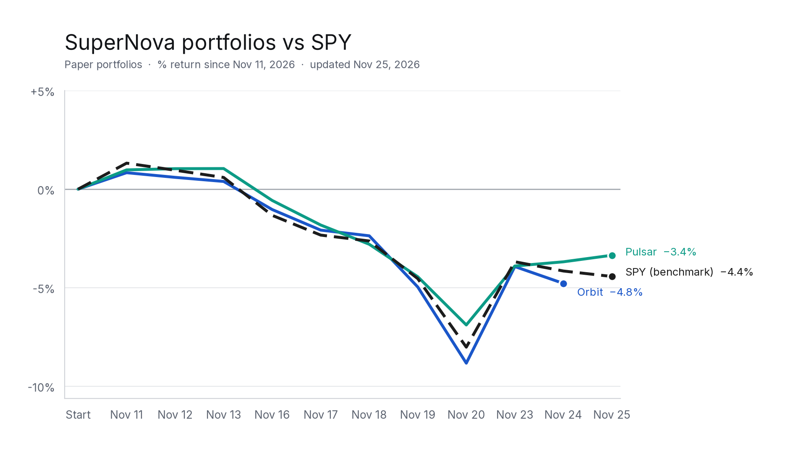

# SuperNova portfolios

These are my SuperNova paper portfolios. They trade paper money, so treat every number here as hypothetical and not investment advice.

The record starts November 11, 2026. Each portfolio starts at what it was worth going into that day (its November 10 closing value), and returns are measured from there against SPY over the same period. Nothing before November 11 is included.

Paper portfolios, percent return since November 11, 2026, compared with SPY.

| Portfolio | Start value (Nov 11, 2026) | Latest close | Return | SPY same period |
|---|---|---|---|---|
| SuperNova Orbit | $6,760.60 | $6,620.11 (Nov 17) | -2.08% | -2.33% |
| SuperNova Pulsar | $6,988.14 | $6,860.95 (Nov 17) | -1.82% | -2.33% |

**SuperNova Orbit** is a concentrated portfolio of high-conviction U.S. stocks, built to compete against the S&P 500. It has no fixed rebalance schedule and trades only when its preset rules are triggered, otherwise holding steady. Risk is managed with position limits and a disciplined drawdown process. It uses settled cash only.

**SuperNova Pulsar** is my steady portfolio of low-cost ETFs. I adjust the mix each quarter, aiming to beat the S&P 500 with smaller drops.

Each portfolio's folder lists what it held at the start, every trade since, its daily closing value and its current holdings. Each day's files are timestamped in `proofs/` so the record can't be changed later without it showing.
