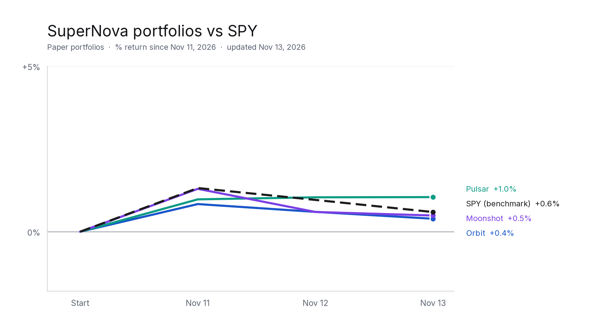

# SuperNova portfolios

These are my SuperNova paper portfolios. They trade paper money, so treat every number here as hypothetical and not investment advice.

The record starts November 11, 2026. Each portfolio starts at what it was worth going into that day (its November 10 closing value), and returns are measured from there against SPY over the same period. Nothing before November 11 is included.

Paper portfolios, percent return since November 11, 2026, compared with SPY.

| Portfolio | Start value (Nov 11, 2026) | Latest close | Return | SPY same period |
|---|---|---|---|---|
| SuperNova Orbit | $6,760.60 | $6,787.06 (Nov 13) | +0.39% | +0.59% |
| SuperNova Moonshot | $5,159.01 | $5,184.24 (Nov 13) | +0.49% | +0.59% |
| SuperNova Pulsar | $6,988.14 | $7,061.18 (Nov 13) | +1.05% | +0.59% |

**SuperNova Orbit** is a concentrated growth portfolio of up to 20 high-conviction U.S. stocks, built to compete against the S&P 500. It pairs leaders in fast-growing themes like technology with a core of high-quality companies, and shifts weight toward what is working. Risk is managed with strict position and sector limits, a small cash buffer and a disciplined drawdown process. Orbit is reviewed weekly.

**SuperNova Moonshot** is my high-risk, high-reward portfolio of smaller and mid-size U.S. growth companies. It lets winners run, cuts losers and can sit largely in cash between opportunities. Expect big swings.

**SuperNova Pulsar** is my steady portfolio: about a dozen high-quality, consistently profitable U.S. companies held in roughly equal weights and mostly left alone. Pulsar is reviewed quarterly.

Each portfolio's folder lists what it held at the start, every trade since, its daily closing value and its current holdings. Each day's files are timestamped in `proofs/` so the record can't be changed later without it showing.
